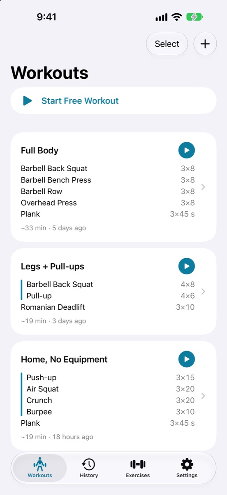
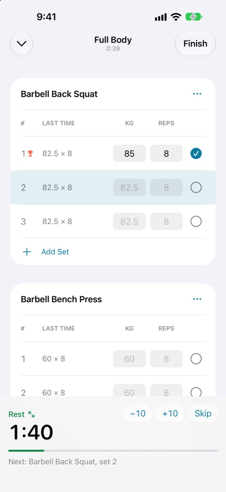
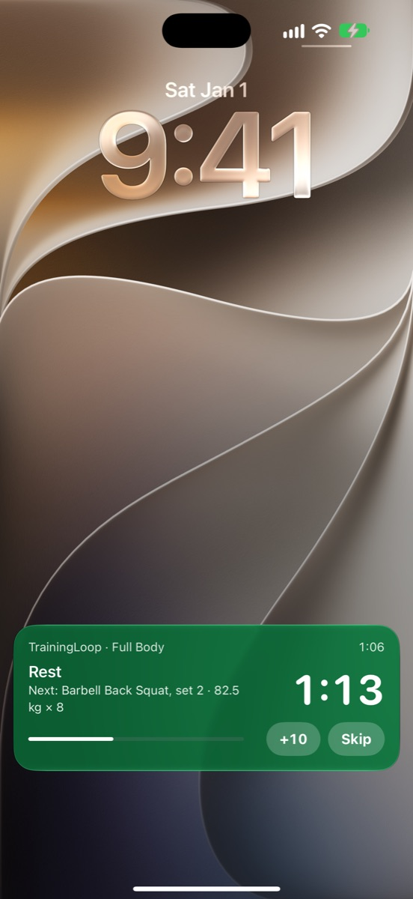
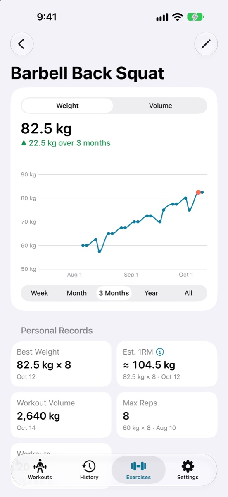

<h1 align="center">TrainingLoop</h1>

Workout log for iPhone — plan once, then just tick sets. 
<a href="https://personan1.github.io/TrainingLoop/">Website</a> · <a href="https://t.me/setnewloop">Telegram</a> · <a href="https://personan1.github.io/TrainingLoop/support/">Support</a> · <a href="https://personan1.github.io/TrainingLoop/privacy/">Privacy</a>

**Status:** in development, coming soon to the App Store. From the maker of [SetLoop](https://github.com/PersonaN1/SetLoop).

## How it works

- **Template** — the plan of one workout: exercises in order, a list of sets for each (reps or time, weight), rest between sets. Neighbouring exercises can be merged into a **superset** and done in rounds.
- **Workout** — started from a template or empty. Every set shows what you did last time and the fields are already filled in; tick a set and the rest timer starts by itself.
- **History** — finished workouts with their sets. Records and charts are counted from it; a past workout can be edited or added later.

## Features

- Templates with supersets, pyramids and warm-up sets; free workouts without a plan.
- "Last time" numbers next to every set; the fields fill in for you.
- Rest timer with sounds, voice prompts and vibration; option to ignore the Silent switch.
- Live Activity on the Lock Screen and in the Dynamic Island: rest with +10 and Skip, the current set with Done.
- Personal records 🏆: heaviest weight, best weight for 1, 3, 5, 8 and 10 reps, reps, time and volume.
- A chart for every exercise: best weight, volume, reps or time by week, month, 3 months, year or all time; estimated 1RM for reference.
- History with a summary by week, month and year: workouts, time, volume, sets by muscle group, streak of weeks.
- 53 built-in exercises plus your own; kilograms or pounds.
- Light and dark theme, Russian and English.
- iOS 17+, iPhone. Free, no ads, no accounts, no data collected.

## Contact

News and questions — Telegram [@setnewloop](https://t.me/setnewloop). Bug reports are also welcome in [GitHub Issues](https://github.com/PersonaN1/TrainingLoop/issues).

## Documentation

- [Product spec](docs/SPEC.md)
- [Design](docs/DESIGN.md)
- [Technical design](docs/TECH.md)
- [Domain terms](CONTEXT.md) and [decision records](docs/adr)

## Building

- Xcode 26+ (Swift 6), iOS 17.0+. The project is described in `project.yml` ([XcodeGen](https://github.com/yonaskolb/XcodeGen) 2.46.0); the generated `TrainingLoop.xcodeproj` is committed — run `xcodegen generate` after editing `project.yml`.
- Signing: create `Config/Local.xcconfig` (not in git) with the line `DEVELOPMENT_TEAM = <your Team ID>`.
- Domain tests: `xcodebuild test -scheme TrainingLoopCore -destination 'platform=macOS'` in `Packages/TrainingLoopCore` (CI does the same). `swift test` works with Xcode 27+; with Xcode 26 it doesn't compile the package's String Catalog and the exercise name tests fail.

## Support the project

TrainingLoop is free and has no ads. If you like it, you can [buy the developer a coffee](https://pay.cloudtips.ru/p/7fee0c9b) ☕

## License

Copyright © 2026 Aleksandr Vasilev. All rights reserved. The source code is published for reference only; no license is granted to copy, modify or distribute it. See [LICENSE](LICENSE) and [CONTRIBUTING.md](CONTRIBUTING.md).
